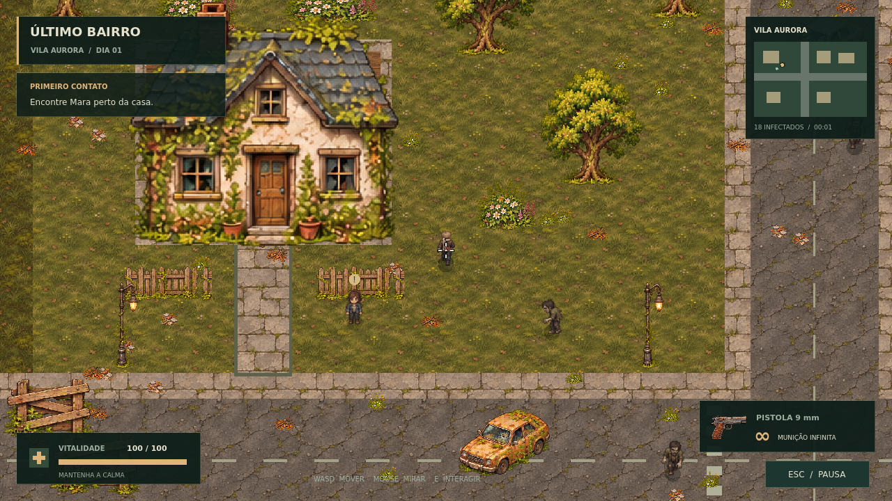

# Último Bairro

Um protótipo de sobrevivência pós-apocalíptica para PC: explore Vila Aurora,
converse com uma sobrevivente e enfrente os infectados com uma pistola de
munição infinita. Desenvolvido em **Godot 4.6.3**, com visão de cima em 2D.



## Jogar

**Windows x64:** extraia `UltimoBairro-0.1.1-Windows.zip` e abra
`UltimoBairro.exe`. Não precisa instalar Godot.

**Linux x64:** extraia `UltimoBairro-0.1.1-Linux.zip` e execute
`./UltimoBairro.x86_64`. Se necessário, use `chmod +x UltimoBairro.x86_64`.

Os pacotes são gerados em `builds/`; os executáveis não ficam no histórico Git.
Esta versão de Windows foi exportada em Linux e ainda precisa de um teste
em uma máquina Windows. Não há instalador, salvamento ou multiplayer.

### Executar pelo editor

1. Instale [Godot 4.6.3 Standard](https://godotengine.org/download/archive/4.6.3-stable/)
   (não é necessário .NET).
2. Clone ou baixe este repositório.
3. Importe `project.godot` no Godot e pressione **F6** com a cena principal
   aberta, ou **F5** para executar o projeto.

Pelo terminal, com Godot no PATH:

```sh
godot --path . --editor
godot --path .
```

## Controles

| Ação | Controle |
| --- | --- |
| Caminhar | WASD ou setas |
| Mirar | Mouse, em qualquer direção |
| Ajustar o zoom | Roda do mouse |
| Atirar | Botão esquerdo; segure para repetir |
| Abrir/fechar portas, conversar, avançar fala | E |
| Pausar ou encerrar conversa | Esc |
| Ativar/desativar áudio | M |
| Alternar tela cheia | F11 |

Você começa dentro da casa 07. Aproxime-se da porta e pressione **E** para sair.
Mara está no jardim, à direita. Tiros atraem os infectados; paredes e portas
fechadas bloqueiam disparos e a passagem dos zumbis.

## O que já existe

- Um personagem, mira independente da movimentação e uma pistola infinita.
- 18 zumbis com percepção por visão e som, perseguição, navegação e ataque.
- Vida, dano, morte, reinício e objetivo de limpar o bairro.
- Cinco construções com portas físicas e interiores acessíveis.
- Ruas, praça, árvores, cercas, barricadas e carros abandonados.
- Uma NPC com diálogo, minimapa, menus, efeitos e áudio.
- Sprites ilustrados para casas, árvores, veículos, móveis e personagens,
  com quatro direções de movimento e terreno texturizado.

**Não implementados nesta etapa:** coleta, inventário, saque de corpos/móveis,
outras armas, munição finita, fome/sede, salvamento, multiplayer e mundo infinito.
O mapa é uma área finita e contínua de 2304 × 1536 unidades.

## Organização

```text
scenes/main.tscn          Cena de entrada
src/main.gd              Ciclo da partida, interações e diálogos
src/actors/              Jogador, zumbis e sobrevivente
src/world/               Bairro, colisões, portas e telhados
src/systems/             Dados da arma, áudio e efeitos
src/ui/                  Interface e menus
resources/pistol.tres     Atributos editáveis da pistola
art/                     Sprites, fontes e sons
tests/                   Testes integrados executados pelo Godot
tools/                   Geração de assets, capturas e exportação
docs/                    Design, plano de evolução e imagens
```

## Validar

Não há dependências ou plugins externos necessários para rodar o jogo.
Na primeira execução, importe os assets antes dos testes:

```sh
godot --headless --path . --editor --import --quit
godot --headless --path . --fixed-fps 60 --script res://tests/run_tests.gd
```

Os testes simulam movimentação e colisões, abertura de porta e atualização da
navegação, disparos, paredes, dano/morte, diálogo, pausa e reinício. A saída
`RESULT` deve indicar todas as verificações aprovadas.

## Exportar para PC

Instale os modelos de exportação **4.6.3** em Editor → Gerenciar modelos de
exportação, ou baixe apenas os modelos de release para PC:

```sh
python3 tools/fetch_export_templates.py --destination "$HOME/.local/share/godot/export_templates/4.6.3.stable"
mkdir -p builds/windows builds/linux
godot --headless --path . --export-release "Windows Desktop" builds/windows/UltimoBairro.exe
godot --headless --path . --export-release "Linux" builds/linux/UltimoBairro.x86_64
```

O destino de modelos do comando Python acima é o padrão do Linux; em Windows
ou macOS, prefira o instalador do próprio Godot. Os presets exportam o pacote
do jogo embutido no executável. Com os modelos instalados, `python3 tools/build.py`
importa, testa, exporta e gera os dois ZIPs com as licenças e instruções.
A pipeline do GitHub valida cada push e pode
gerar os dois pacotes pela ação manual ou por uma tag `v*`.

## Arte e referências

A direção de jogo tem referências em Project Zomboid, Stardew Valley e
Resident Evil 4. O protótipo usa sprites e sons produzidos para este projeto,
sem arquivos extraídos desses jogos. As fontes DejaVu mantêm sua licença em
[`art/FONT-LICENSE.txt`](art/FONT-LICENSE.txt). As imagens de origem ficam em
`art/source/`, e `python3 tools/pack_art.py` (com Pillow instalado) extrai as
texturas e alinha os quadros para o Godot. Para regenerar os sons, execute
`python3 tools/generate_audio.py`.

O código e os assets próprios não receberam licença pública nesta etapa.
Consulte [o documento de design](docs/DESIGN.md) e
[o plano de evolução](docs/ROADMAP.md) antes de ampliar o escopo.
