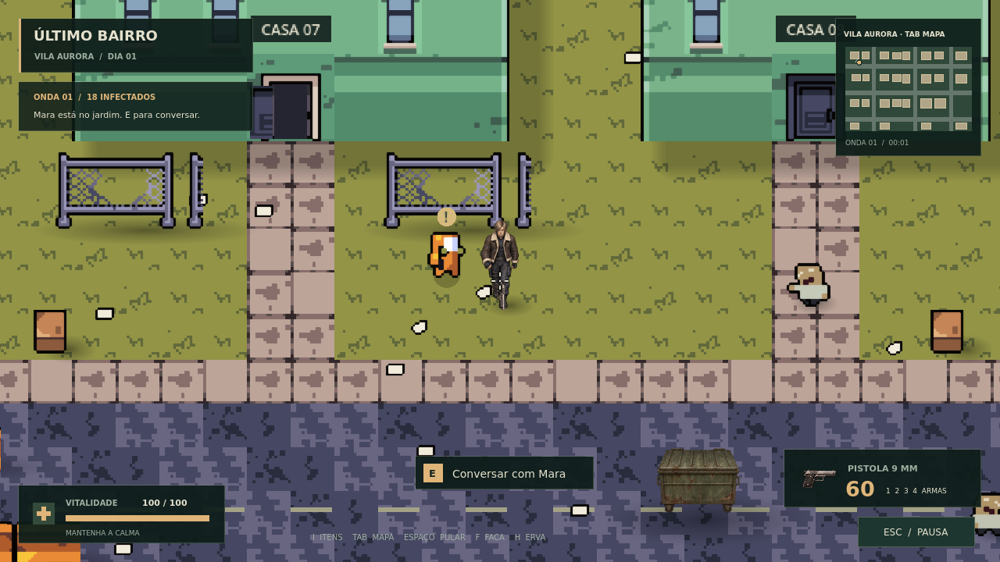
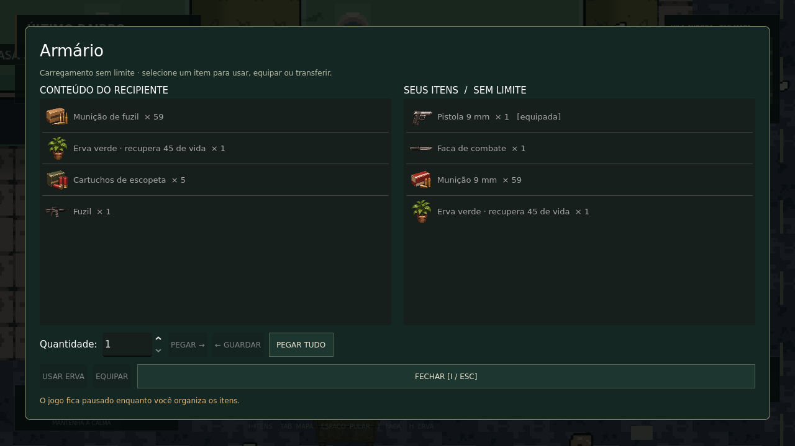
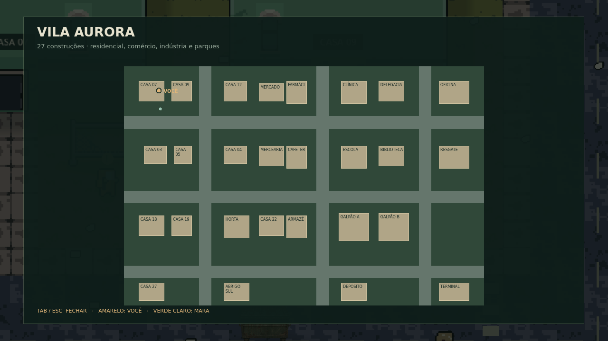

# Último Bairro

Protótipo de sobrevivência para PC em **Godot 4.6.3**. Explore Vila Aurora,
converse com Mara e sobreviva a ondas crescentes de infectados.
A versão **0.3.0** amplia o bairro, o combate e a exploração.



## Baixar e jogar

Abra [Releases](https://github.com/vagner-cv/ultimo-bairro/releases) e baixe:

- **Windows x64:** `UltimoBairro-0.3.0-Windows.zip`. Extraia tudo e abra
  `UltimoBairro.exe`.
- **Linux x64:** `UltimoBairro-0.3.0-Linux.zip`. Extraia e execute
  `./UltimoBairro.x86_64`. Se necessário, use `chmod +x UltimoBairro.x86_64`.

Os executáveis não precisam de Godot, Python ou instalação de assets.
O pacote Windows foi exportado em Linux e ainda precisa de validação em Windows.
Esta entrega é para PC; ainda não há versão publicada para navegador.

## Controles

| Ação | Controle |
| --- | --- |
| Caminhar | WASD ou setas |
| Mirar | Mouse, em qualquer direção |
| Ajustar zoom | Roda do mouse |
| Atirar | Botão esquerdo; segure para repetir |
| Portas / recipientes / conversa | E |
| Inventário sem limite | I |
| Mapa do bairro | Tab |
| Faca / quebrar caixas | F ou botão direito |
| Pular / subir em obstáculos baixos | Espaço |
| Pistola / escopeta / fuzil / faca | 1 / 2 / 3 / 4 |
| Usar erva verde (+45 de vida) | H |
| Filtro suave / pixel clássico | F2 |
| Pausa / encerrar conversa | Esc |
| Ativar ou desativar áudio | M |
| Tela cheia | F11 |

Você começa na casa 07. Use **E** perto da porta para sair; Mara está no jardim
à direita. Tiros atraem infectados. Paredes e portas fechadas bloqueiam o tiro
e o caminho. A partida pode ser reiniciada pelo menu de pausa ou após morrer.

## Escopo atual

- Bairro contínuo de **4608 × 3072 unidades**, quatro vezes a área anterior,
  com **27 construções acessíveis**, comércio, clínica, delegacia, escola,
  galpões, áreas residenciais e dois parques.
- Ondas: 18, 26, 34… infectados; **12 segundos** de intervalo após eliminar
  todos. A próxima onda chega longe do jogador e entra gradualmente, com
  até 42 inimigos ativos simultaneamente para limitar o custo de simulação.
- Pistola (34 de dano), fuzil (25, disparo rápido) e escopeta (6 × 19 por tiro),
  cada um consumindo sua munição. As reservas são usadas diretamente, sem recarga.
- Faca (36 de dano), caixas de madeira (dois golpes) e papelão (um golpe).
- Ervas verdes recuperam 45 de vida. Drops aleatórios dos zumbis e loot em
  armários, gaveteiros, lixeiras e caixas; alguns recipientes podem estar vazios.
- Inventário sem limite, com listas lado a lado para transferir quantidades,
  pegar tudo, guardar itens, equipar e usar ervas. A faca permanece com o jogador.
- Pulo com altura e pouso sobre objetos baixos; paredes continuam bloqueando.
- Sprite próprio do Leon de RE4 em quatro direções, novos ícones, filtro de
  suavização das diagonais, sombras suaves e sinalização dos prédios.

Você começa com pistola, 60 munições 9 mm, faca e uma erva. O armário da primeira
casa contém um fuzil; a caixa de madeira tem uma escopeta. A mira é livre em 360°.
O conteúdo dos recipientes e o inventário duram **a partida atual**. Ainda não
há salvamento entre sessões, multiplayer ou fome/sede.




## Abrir o código no Godot

1. Instale [Godot 4.6.3 Standard](https://godotengine.org/download/archive/4.6.3-stable/)
   e Python 3.10 ou superior.
2. Clone este repositório.
3. Prepare os assets gratuitos do autor:

```sh
python3 -m venv .venv
# Linux/macOS: source .venv/bin/activate
# Windows PowerShell: .venv\Scripts\Activate.ps1
python -m pip install -r requirements-tools.txt
python tools/prepare_assets.py
```

Também é possível baixar o ZIP gratuito na página do autor e executar:

```sh
python tools/prepare_assets.py --archive /caminho/para/o/kit.zip
```

4. Importe `project.godot` no Godot e pressione **F5**.

A arte licenciada fica em `art/vendor/`, ignorada pelo Git. O código de
preparação baixa o arquivo público do autor, verifica seu SHA-256 e prepara
apenas os PNGs usados pelo jogo. Os PNGs não acompanham os arquivos de código
do GitHub; os executáveis incluem a arte embutida na partida.

## Validar e exportar

Depois de preparar os assets:

```sh
godot --headless --path . --editor --import --quit
godot --headless --path . --fixed-fps 60 --script res://tests/run_tests.gd
```

Há 80 verificações de gameplay, incluindo inventário, munições, loot, ondas,
faca, salto, navegação, portas, diálogos, pausa e reinício. Para exportar, instale os modelos 4.6.3 em
Editor → Gerenciar modelos de exportação e execute `python tools/build.py`.
O comando valida, exporta Windows/Linux e monta ZIPs em `builds/` com os avisos
de licença e instruções. A pipeline do GitHub valida os pushes e oferece builds
pela execução manual ou por uma tag `v*`.

## Estrutura e créditos

`src/actors/` contém os personagens, `src/world/` o bairro e portas,
`src/systems/` armas/áudio/arte, e `src/ui/` a interface. As armas são configuradas
em `resources/*.tres`; itens, inventário e loot ficam em `src/systems/`.

- Arte: [Free Zombie Apocalypse Top-Down Pixel Art Kit — CraftPix](https://free-game-assets.itch.io/free-zombie-apocalypse-top-down-pixel-art-kit).
- [Aviso de uso da CraftPix](art/CRAFTPIX-NOTICE.txt), [fontes DejaVu](art/FONT-LICENSE.txt)
  e [Godot](art/GODOT-LICENSE.txt).
- [Design](docs/DESIGN.md), [evolução](docs/ROADMAP.md) e [validação](docs/VALIDATION.md).

O código e os sons próprios ainda não receberam licença pública. A arte da
CraftPix segue a licença do autor e não pode ser redistribuída como asset pack.
